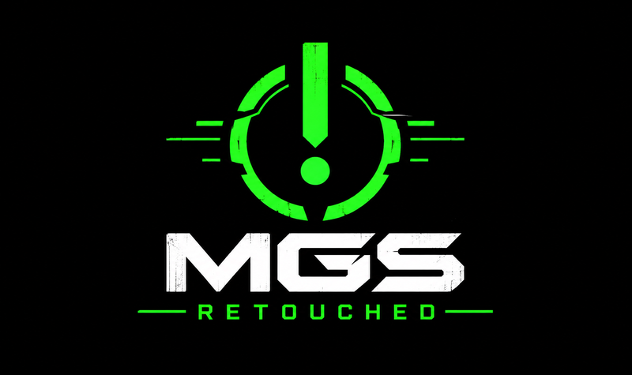

<p align="center"></p>

# METAL GEAR SOLID RETOUCHED: Android builder

Rebuilds **METAL GEAR SOLID RETOUCHED**, an enhanced Android edition of *Metal Gear Solid Touch*
(iPhone, 2009), from **your own copy of the iPhone app**.

This repository contains **no game code, art, sound or text**. You supply the game as an `.ipa`;
the builder decompiles it on your PC, adds the RETOUCHED runtime, and gives you an Android APK.

## What you need

- Your own **MGS Touch v2.3.0 .ipa**, decrypted (the builder checks the executable and stops
  with a clear message if it is another version or still encrypted).
- A Linux PC, x86-64 (tested on Fedora 43), about 15 GB free disk and 8 GB RAM.

## One command

```
./build_apk.sh doctor                         # checks the machine, prints how to fix anything missing
./build_apk.sh all --ipa "MGS Touch.ipa"      # writes out/mgs-retouched.apk
```

`all` does everything:

1. downloads the pinned helpers into `deps/` (wasm2c, FreeType, fonts; checksums verified);
2. fetches the decompiler ([MetalGearSolidTouch-Decompilation-](https://github.com/etruj/MetalGearSolidTouch-Decompilation-))
   at the version this builder was tested with, into `deps/decomp`;
3. decompiles your IPA with its `reproduce.sh` (about 25 minutes the first time; it offers to install
   Ghidra and a JDK and asks before installing anything; add `--yes` to allow it without asking);
4. builds the game module with the RETOUCHED runtime, then the Android app, and writes
   **`out/mgs-retouched.apk`** (about 290 MB: it contains your game).

Already decompiled? Point `--decomp` at your decompiler checkout, or start from its output:

```
./build_apk.sh build --handoff /path/to/PORT_HANDOFF --ipa "MGS Touch.ipa"
```

Later builds take a few minutes. Use `--out FILE.apk` to choose where the APK goes.

## What the machine needs

python3, clang 19 or newer with wasm-ld, cmake + a C++ compiler, git, curl/tar/zip/unzip, a JDK
(javac, keytool), and the Android SDK with build-tools, a platform and the NDK (r26 or newer).
`./build_apk.sh doctor` lists exactly what is missing and the command to install it. No Gradle
and no Android Studio project: the APK is put together directly with aapt2, d8 and apksigner.

## Install and play

Enable USB debugging on the phone, connect it, then `adb install -r out/mgs-retouched.apk`
(or copy the APK to the phone and open it, allowing installs from that source).

- The app is **MGS RETOUCHED** (`com.mgsport.retouched`), arm64 phones, Android 9 or newer.
- Each PC signs with its own local key (`build/debug.keystore`). To replace an APK built on another
  PC, uninstall the old one first (`adb uninstall com.mgsport.retouched`), after backing up your
  save from the RETOUCHED menu.
- The game runs in portrait like the iPhone original: turn the phone for the missions.

## What RETOUCHED adds

With every option off it plays exactly like the original. A **RETOUCHED** entry in the game's own
main menu opens the options:

- **Graphics:** sharp rendering at the phone's resolution, full screen, screen-fill styles.
- **Sound:** separate music and effects volume, high-quality resampling.
- **Controls:** aim sensitivity, touch tolerance, gyro aiming, game controllers, vibration.
- **Game:** in-mission pause (button, Back key, or leaving the app), quit mission, skip intro logos,
  language override.
- **Extras:** art gallery, sound test, save backup / restore and export / import.
- **Cheats:** open all missions, open all wallpapers (and a few unmarked ones).

## How it works

The decompiled C is compiled unchanged in meaning to WebAssembly (which keeps the original 32-bit
memory layout), translated back to C with wasm2c, and compiled for Android with the NDK, together
with a replacement for the iOS frameworks (Objective-C runtime, Foundation, UIKit, CoreGraphics,
OpenGL ES, OpenAL, AudioQueue) and the RETOUCHED add-ons. The game's art and sound are packed
into the APK unchanged from your IPA.

| folder | what it is |
|---|---|
| `engine/tools/` | the build: decompiled C transform, wasm build, toolchain detection, checks |
| `engine/rt/` | the iOS runtime inside the game module |
| `engine/host/` | the native host: graphics, audio mixer, text, touch, files |
| `android-vanilla/` | the Android host and the APK assembly script shared with the original port |
| `android-retouched/` | the RETOUCHED add-ons: `rt/` in the module, `host/` options screen and pause, `app/` manifest, activity, icon |
| `docs/HANDOFF_DEFECTS.md` | the decompilation defects the build fixes along the way |

`VERSION` names the source revision this folder was made from.

## Please share this folder, not the APK

The APK you build contains the game. Keep it for your own devices.

The code in this repository is MIT licensed (`LICENSE`); that does not cover the game you supply.
The Bebas Neue font is under the SIL Open Font License (`android-retouched/fonts/OFL-BebasNeue.txt`).
The fonts and FreeType downloaded into `deps/` keep their own licenses.
The MGS RETOUCHED logo (`logo.png`) is this project's own artwork.
Metal Gear Solid is a trademark of Konami; this project is not affiliated with or endorsed by Konami.
